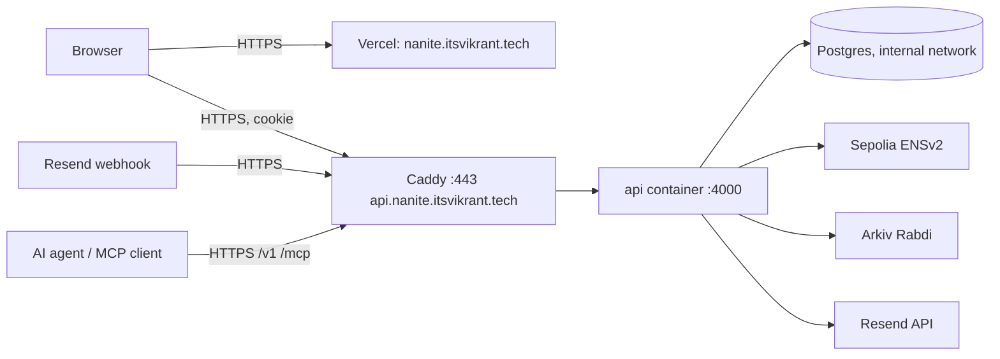

# Deploying Nanite

This is the plan and runbook for the hackathon deployment (task T4.3). Part A explains the setup and the decisions. Part B lists the files that make it work (built and tested in Docker before anything touches the server). Part C is the step-by-step for Vikrant. Part D covers checks, operations and rollback.

## Part A: what we deploy and where

| Piece | Where | Public name |
| --- | --- | --- |
| Web app (Next.js, `apps/web`) | Vercel (free) | `https://nanite.itsvikrant.tech` |
| API (Hono, `apps/api`) | AWS Lightsail, Docker | `https://api.nanite.itsvikrant.tech` |
| Postgres 17.6 | Same Lightsail VM, Docker, not exposed | none |
| TLS + reverse proxy | Caddy on the VM (automatic Let's Encrypt) | ports 80/443 |
| Mail | Resend, domain `nanitecom.itsvikrant.tech` (already verified) | agent addresses |
| Chains | Sepolia (ENSv2), Arkiv Rabdi | unchanged |
| Images | GitHub Container Registry (GHCR), built by GitHub Actions | `ghcr.io/<github-user>/nanite-api:<git-sha>` |



### Decisions (and why)

1. **Both names under `itsvikrant.tech`.** The session cookie is `SameSite=Lax`. `nanite.itsvikrant.tech` and `api.nanite.itsvikrant.tech` are the same *site* (same registrable domain), so the browser sends the cookie on the web app's credentialed API calls. A `*.vercel.app` frontend would be a different site and sign-in would break.
2. **The API is reached directly, not through a Vercel rewrite.** Webhooks, agents and MCP clients need a stable API host anyway, and keeping one origin for everything avoids double proxying.
3. **Cloudflare records for both names are "DNS only" (grey cloud).** Caddy gets its certificate with the HTTP-01 challenge on port 80, and Vercel issues its own certificate. Proxying through Cloudflare can be added later if needed.
4. **Fresh production database.** Production starts empty with new `NANITE_MASTER_KEY` and `SENDER_HASH_SECRET` values. The demo user is created again through the real web onboarding. Dev and `nanite_live` data stay local.
5. **The same operator wallets as development.** `OPERATOR_PRIVATE_KEY` (ENS operator, holds the roles on `nanitecom.eth`) and `ARKIV_OPERATOR_PRIVATE_KEY` (Arkiv writer, holds tGLM) move to the server. They are copied as a file over SSH, never pasted into chat, a ticket or a repo. The owner wallet `0x8fFD…a542` never goes to the server.
6. **Images are built in CI, not on the VM.** A 2 GB VM can build the image, but it is slow and competes with Postgres. CI pushes `nanite-api:<git-sha>` and `:latest` to GHCR; the server only pulls. A no-registry fallback (`docker save | ssh docker load`) is in Part D.
7. **One Resend webhook.** The free plan allows one endpoint, so it moves from the dev tunnel to `https://api.nanite.itsvikrant.tech/webhooks/resend`. The signing secret stays the same.
8. **Production flags.** `NODE_ENV=production` (Secure cookies, no dev routes, no fake providers), `DEV_ROUTES`, `FAKE_RESEND_*` and `WEBHOOK_SYNC` unset.

### Capacity on the 2 GB / 2 vCPU VM

| Process | Expected memory |
| --- | --- |
| Postgres 17 (tuned small: `shared_buffers=128MB`) | 150–250 MB |
| API (Node 22 + tsx) | 200–350 MB |
| Caddy | 30–50 MB |
| Ubuntu + Docker | ~400 MB |

That leaves headroom. A 2 GB swap file is added as a safety net.

## Part B: files to build (built and tested in Docker before the server)

| File | Purpose |
| --- | --- |
| `apps/api/Dockerfile` | Multi-stage image. Stage 1 runs `npm ci --omit=dev --ignore-scripts -w apps/api --include-workspace-root` (the API also imports `packages/mcp`, so the workspaces are `db, crypto, arkiv, ens, mcp`; `tsx` moved to the API's `dependencies` because the API runs TypeScript source). Stage 2 is `node:22.23.3-slim` pinned by the multi-arch index digest `sha256:3ed98443…fddbe9`, user `node` (uid 1000), only `src`, migrations, the JSON files `@nanite/ens` imports and `node_modules`. `CMD` runs `node --import tsx …/migrate.ts && exec node --import tsx src/index.ts` (no npm at runtime). Healthcheck on `/health` using node. Image ~508 MB uncompressed (arm64 local build). |
| `.dockerignore` | Keeps `node_modules`, `.env*`, `.git`, `e2e`, artifacts and local key folders out of the build context. |
| `deploy/docker-compose.prod.yml` | Services `db` (postgres:17.6 pinned, volume `pgdata`, internal network only, small-memory tuning), `api` (GHCR image, `env_file: .env`, depends on healthy db, restart unless-stopped, log rotation), `caddy` (`caddy:2.11.6`, ports 80/443, volumes for data and config). No published Postgres port. The compose file forces `NODE_ENV=production`, `PORT=4000` and `TRUST_PROXY=1` for the API; `mem_limit` 450m / 700m / 150m. Optional variables `API_IMAGE`, `CADDYFILE`, `HTTP(S)_BIND`, `HTTP(S)_PORT` exist only for the local test; leave them unset on the server. `deploy/Caddyfile.local` is the localhost variant for that test. |
| `deploy/Caddyfile` | `api.nanite.itsvikrant.tech { reverse_proxy api:4000 }` plus security headers, request size limit (1 MB; webhook and send bodies are smaller), and access logs without query strings. |
| `deploy/.env.production.example` | Every server variable with a comment and an empty or public value (see Part C step 6). |
| `deploy/backup.sh` | `pg_dump` (custom format) into `/opt/nanite/backups`, keeps the last 14, run nightly from cron. |
| `deploy/deploy.sh` | On the server: `docker compose pull api && docker compose up -d && docker image prune -f`, then waits for `/health`. Takes an optional image tag for rollback. |
| `.github/workflows/api-image.yml` | On push to `main` (paths `apps/api`, `packages`, lockfile): build `apps/api/Dockerfile` for `linux/amd64`, push `ghcr.io/<owner>/nanite-api:<sha>` and `:latest` using the built-in `GITHUB_TOKEN`. |
| `apps/web/vercel.json` | **Not needed.** The dashboard settings in step 9 (root directory `apps/web` with "Include files outside the root directory", install `cd ../.. && npm ci`) are enough. `next build` with `NODE_ENV=production` was verified in Docker. |
| Small code changes | `next.config.ts`: `allowedDevOrigins` is set only when `NODE_ENV !== "production"`. API: `TRUST_PROXY=1` makes `apps/api/src/net/client-ip.ts` use the rightmost `X-Forwarded-For` entry (what Caddy saw); it feeds a new per-IP limit (60/min) on `/auth/nonce` and `/auth/verify`. Confirmed: the session cookie is `Secure` when `NODE_ENV=production`, CORS allows exactly `WEB_ORIGIN` with credentials (test added), `DEV_ROUTES`, `FAKE_RESEND_*` and `WEBHOOK_SYNC` are ignored in production. `live-resend.ts --webhook-endpoint=<url>` moves the single Resend webhook. |

**Local proof before the server:** build the image, run `deploy/docker-compose.prod.yml` locally with a local Caddyfile on `localhost` (internal CA), and check that migrations run, `/health` answers through Caddy, the dev web app can sign in against it with `NODE_ENV=production` cookies over HTTPS, and the container runs as non-root.

**Result of the local proof (2026-11-06, arm64, project `nanite-proof`, ports 127.0.0.1:8080/8443):**
```bash
docker build -f apps/api/Dockerfile -t nanite-api:local .
# in a temp folder with docker-compose.prod.yml (as docker-compose.yml), Caddyfile.local and a throwaway .env:
#   API_IMAGE=nanite-api:local CADDYFILE=./Caddyfile.local HTTP_BIND=127.0.0.1 HTTP_PORT=8080 HTTPS_BIND=127.0.0.1 HTTPS_PORT=8443 + dummy secrets
docker compose -p nanite-proof up -d
```
Migrations applied (13 tables), `/health` answered through Caddy over HTTPS, the process runs as `node` (uid 1000), the image holds no `.env`, keys, tests or docs, Postgres publishes no port, the Caddy access log shows the path without the query string and without request headers, the rate limit answered 429 after 60 sign-in requests from one client. Idle memory: api ~105 MB, db ~49 MB, caddy ~14 MB. The Resend/chain features stayed unconfigured (the API logs that Arkiv uses the in-memory writer) and it still started.

## Part C: step-by-step for Vikrant

Commands marked **[server]** run in an SSH session on the Lightsail VM. Commands marked **[laptop]** run in Docker on your Mac, as usual. Nothing secret is pasted into chat at any step.

### Step 1: GitHub repository (needed for GHCR images and for Vercel)
1. Create a GitHub repository (public is simplest for judges; the code holds no secrets).
2. Push the local `main` (I give the exact commands when you are ready; no commits are made without you).
3. In the repository settings → Actions → General → Workflow permissions: allow "Read and write" so the workflow can push to GHCR.
4. After the first image build, open the package `nanite-api` in your GitHub profile → Package settings → set visibility to **Public** (then the server pulls without a token). If you keep it private, the server needs a read-only token (`docker login ghcr.io`).

### Step 2: Lightsail networking
1. Lightsail → your instance → **Networking**:
   - Create and attach a **static IP** (free while attached). Note it as `<STATIC_IP>`.
   - IPv4 firewall: keep **SSH 22** but restrict it to your own IP ("Restrict to IP address"), add **HTTP 80** and **HTTPS 443** from anywhere. Remove anything else.
2. Download the instance SSH key from Lightsail (Account → SSH keys) if you don't already use one, then connect:
   `ssh -i ~/.ssh/<lightsail-key>.pem ubuntu@<STATIC_IP>`

### Step 3: DNS in Cloudflare (zone `itsvikrant.tech`)
| Type | Name | Value | Proxy |
| --- | --- | --- | --- |
| A | `api.nanite` | `<STATIC_IP>` | DNS only |
| CNAME | `nanite` | given by Vercel in step 9 (usually `cname.vercel-dns.com`) | DNS only |

Do not touch the existing `nanitecom` mail records.

### Step 4: prepare Ubuntu [server]
```bash
sudo apt-get update && sudo apt-get -y upgrade
sudo apt-get -y install ca-certificates curl unattended-upgrades
sudo dpkg-reconfigure -plow unattended-upgrades          # answer Yes

# 2 GB swap
sudo fallocate -l 2G /swapfile && sudo chmod 600 /swapfile
sudo mkswap /swapfile && sudo swapon /swapfile
echo '/swapfile none swap sw 0 0' | sudo tee -a /etc/fstab

# Docker Engine + compose plugin from Docker's official apt repository
sudo install -m 0755 -d /etc/apt/keyrings
sudo curl -fsSL https://download.docker.com/linux/ubuntu/gpg -o /etc/apt/keyrings/docker.asc
echo "deb [arch=$(dpkg --print-architecture) signed-by=/etc/apt/keyrings/docker.asc] https://download.docker.com/linux/ubuntu $(. /etc/os-release && echo $VERSION_CODENAME) stable" | sudo tee /etc/apt/sources.list.d/docker.list
sudo apt-get update && sudo apt-get -y install docker-ce docker-ce-cli containerd.io docker-compose-plugin
sudo usermod -aG docker ubuntu && newgrp docker
docker run --rm hello-world
```

### Step 5: app folder [server]
```bash
sudo mkdir -p /opt/nanite/backups && sudo chown -R ubuntu:ubuntu /opt/nanite
cd /opt/nanite
# copy from the repo (raw GitHub URLs or scp from your laptop):
#   deploy/docker-compose.prod.yml -> /opt/nanite/docker-compose.yml
#   deploy/Caddyfile               -> /opt/nanite/Caddyfile
#   deploy/backup.sh, deploy/deploy.sh -> /opt/nanite/ (chmod +x)
```

### Step 6: production secrets file [server]
Create `/opt/nanite/.env` from `deploy/.env.production.example`, then `chmod 600 /opt/nanite/.env`.

| Variable | Value |
| --- | --- |
| `GHCR_OWNER` | lower-case GitHub user that owns the image (used by the compose file) |
| `NODE_ENV` | `production` (the compose file also forces it, plus `TRUST_PROXY=1`) |
| `DATABASE_URL` | `postgres://nanite:<DB_PASSWORD>@db:5432/nanite` |
| `POSTGRES_PASSWORD` | `<DB_PASSWORD>`: generate on the server with `openssl rand -hex 24` |
| `WEB_ORIGIN` | `https://nanite.itsvikrant.tech` |
| `API_PUBLIC_URL` | `https://api.nanite.itsvikrant.tech` |
| `AUTH_CHAIN_ID` | `11155111` |
| `SEPOLIA_RPC_URL` | your RPC URL (a keyed provider is better than the public one) |
| `OPERATOR_PRIVATE_KEY` | copy from your laptop `.env` (see below) |
| `ARKIV_OPERATOR_PRIVATE_KEY` | copy from your laptop `.env` (see below) |
| `ARKIV_ACCESS_KEY` | recommended: free key from hub.arkiv.network (lifts the public RPC rate limit) |
| `NANITE_MASTER_KEY` | NEW: `openssl rand -hex 32` on the server |
| `SENDER_HASH_SECRET` | NEW: `openssl rand -hex 32` on the server |
| `RESEND_API_KEY` | copy from your laptop `.env` (Full access key) |
| `RESEND_WEBHOOK_SECRET` | copy from your laptop `.env` (the `whsec_…` of the existing webhook) |
| `SHARED_MAIL_DOMAIN` | `nanitecom.itsvikrant.tech` |
| `RESEND_DEFAULT_REGION` | `ap-northeast-1` |
| `DAILY_MAIL_QUOTA` | `90` |
| not set | `DEV_ROUTES`, `FAKE_RESEND_CONTENT`, `FAKE_RESEND_SEND`, `FAKE_RESEND_DOMAINS`, `WEBHOOK_SYNC`, `TEST_*` |

Copying the four existing secrets without pasting them anywhere: on your laptop, make a temporary file with only those four lines, `scp` it to the server, append it to `/opt/nanite/.env` there, then delete the temporary file on both sides:
```bash
# [laptop] (in the repo folder)
grep -E '^(OPERATOR_PRIVATE_KEY|ARKIV_OPERATOR_PRIVATE_KEY|RESEND_API_KEY|RESEND_WEBHOOK_SECRET)=' .env > /tmp/nanite-secrets.env
scp -i ~/.ssh/<lightsail-key>.pem /tmp/nanite-secrets.env ubuntu@<STATIC_IP>:/opt/nanite/secrets.part
rm /tmp/nanite-secrets.env
# [server]
cat /opt/nanite/secrets.part >> /opt/nanite/.env && shred -u /opt/nanite/secrets.part && chmod 600 /opt/nanite/.env
```
(These four commands are the only ones in this runbook that run on the Mac outside Docker; they copy a file and touch no project code.)

### Step 7: first start [server]
```bash
cd /opt/nanite
docker compose pull
docker compose up -d
docker compose ps                      # db healthy, api healthy, caddy up
docker compose logs --tail 50 api      # "migrations applied", "nanite-api listening on :4000"
curl -s https://api.nanite.itsvikrant.tech/health   # {"ok":true,"db":"up",...}
```
Caddy obtains the certificate on the first HTTPS request; if `/health` fails, check `docker compose logs caddy` (usually DNS not yet pointing to the static IP, or port 80 closed).

### Step 8: point Resend at production [laptop]
Move the single webhook from the dev tunnel to production (keeps the same secret and all four events):
```bash
docker compose run --rm tools npx tsx apps/api/scripts/live-resend.ts --webhook-endpoint=https://api.nanite.itsvikrant.tech/webhooks/resend
```
(Script mode added in Part B; it uses `PATCH /webhooks/{id}` and prints only the endpoint and events.) After this, stop the dev tunnel: `docker rm -f nanite-tunnel nanite-api-live`.

### Step 9: Vercel (web app)
1. vercel.com → Add New → Project → import the GitHub repository.
2. Settings:
   - Root Directory: `apps/web`, and enable "Include files outside the root directory" (needed for `packages/crypto`).
   - Framework: Next.js. Install command: `cd ../.. && npm ci`. Build command: `npm run build`.
   - Environment variables (Production): `NEXT_PUBLIC_API_BASE_URL=https://api.nanite.itsvikrant.tech`, `NEXT_PUBLIC_SHARED_MAIL_DOMAIN=nanitecom.itsvikrant.tech`, `NEXT_PUBLIC_AUTH_CHAIN_ID=11155111`. Leave `NEXT_PUBLIC_SHOW_STYLEGUIDE` unset.
3. Deploy. Then Settings → Domains → add `nanite.itsvikrant.tech`; add the CNAME it shows in Cloudflare (step 3), DNS only. Wait for the certificate.

### Step 10: backups [server]
```bash
crontab -e
# add:
15 3 * * * /opt/nanite/backup.sh >> /opt/nanite/backups/backup.log 2>&1
```
Download a copy now and then (`scp` from `/opt/nanite/backups`). Backups contain only ciphertext-related records and wrapped keys, but they are still sensitive: keep them private.

## Part D: checks, operations, rollback

### Smoke test after deploy
1. `https://nanite.itsvikrant.tech` loads; "Get started" opens onboarding.
2. Sign in with MetaMask on Sepolia, create keys, claim a username, choose "Start now" (shared domain). This is also the first real browser-wallet test.
3. Add an agent; note its address `<agent>.<user>@nanitecom.itsvikrant.tech`.
4. Send an email from Gmail to that address; it appears decrypted in the inbox within seconds.
5. With the agent token: `curl -H "Authorization: Bearer <token>" https://api.nanite.itsvikrant.tech/v1/inbox` (on your own machine; don't paste the token anywhere).
6. Hosted MCP: `claude mcp add --transport http nanite https://api.nanite.itsvikrant.tech/mcp --header "Authorization: Bearer <token>"`, then ask Claude to list the inbox.
7. Reply through the agent to your Gmail and verify the signature with `verify-mail-signature.ts`.

### Day-to-day
| Task | Command [server] |
| --- | --- |
| Deploy a new image | `./deploy.sh` (pulls `latest`) |
| Logs | `docker compose logs -f --tail 100 api` |
| Restart | `docker compose restart api` |
| Disk | `df -h && docker system df` |
| DB shell | `docker compose exec db psql -U nanite nanite` |

### Rollback
`./deploy.sh <previous-git-sha>` pins the API to an earlier image. Database migrations only add tables or columns, so an older API image keeps working against a newer schema.

### Restore a backup
```bash
docker compose stop api
docker compose exec -T db pg_restore -U nanite -d nanite --clean --if-exists < backups/<file>.dump
docker compose start api
```

### No-registry fallback (if GHCR isn't available)
```bash
# [laptop]
docker build -f apps/api/Dockerfile -t nanite-api:manual --platform linux/amd64 .
docker save nanite-api:manual | gzip | ssh -i ~/.ssh/<key>.pem ubuntu@<STATIC_IP> 'gunzip | docker load'
# [server] set the api image to nanite-api:manual in docker-compose.yml, then docker compose up -d
```

### Security checklist
- [ ] SSH restricted to your IP; only 80/443 open to the world; Postgres has no published port.
- [ ] `/opt/nanite/.env` is mode 600 and owned by `ubuntu`; no secret in the repo, the image or the logs.
- [ ] `NODE_ENV=production`; `DEV_ROUTES` and all `FAKE_*` unset (the `/internal/dev/*` routes are not mounted; unknown paths answer 401 or 404).
- [ ] The owner wallet key is nowhere on the server.
- [ ] Operator balances: ENS operator on Sepolia (alert below 0.05 ETH), Arkiv operator tGLM.
- [ ] Uptime check (e.g. a free UptimeRobot monitor) on `https://api.nanite.itsvikrant.tech/health`.

### After deploy
- Agents created later get `agent-endpoint[mcp] = https://api.nanite.itsvikrant.tech/mcp` automatically. For older test agents on Sepolia, run `update-agent-endpoints.ts --apply` with `API_PUBLIC_URL` set (optional; they live in the dev databases).
- Record the URLs, static IP (not secret) and image tag in `docs/logbook.md`.
