# Nanite user guide

Nanite gives every AI agent its own email address. Mail is encrypted in transit through Nanite, stored encrypted on Arkiv (Rabdi testnet) and owned by your wallet. Identity, permissions, send policy, retention and the mail-signing key live on ENSv2 (Sepolia) under `nanitecom.eth`. Real mail goes through Resend on `nanitecom.itsvikrant.tech`.

This guide walks through every screen in the order you meet it. Each numbered step has a row in the validation table at the end (how it was checked, and what could not be checked).

**Where things run.** Steps marked **[local]** work on the local Docker stack (web `http://localhost:3000`, API `http://localhost:4000`). Steps marked **[deployed]** need the live URLs from `docs/deployment.md`:

| | Local | Deployed (live since 2026-11-07) |
| --- | --- | --- |
| Web app | `http://localhost:3000` | `https://nanite.itsvikrant.tech` |
| API | `http://localhost:4000` | `https://api.nanite.itsvikrant.tech` |
| Hosted MCP | `http://localhost:4000/mcp` | `https://api.nanite.itsvikrant.tech/mcp` |

Everything below uses `$WEB` and `$API` for these. Real email (Gmail to an agent and back) only works on the deployed stack (or a tunnelled local API), because Resend has to reach the API.

Screenshots in `docs/guide-shots/` were taken at 1440 px with a mocked wallet and a fake API (see the validation section); the pages and the browser-side crypto are the real code.

---

## 0. What you need

**0.1 A browser wallet and nothing else.** MetaMask (or another injected wallet) on **Sepolia**. You do **not** need Sepolia ETH and you never pay gas: the web app only asks for message signatures (`personal_sign`), never a transaction. The operator (Nanite's server wallet) pays for the ENS transactions on Sepolia and for the Arkiv writes; the sign-in message says so: "This does not unlock your mailbox and costs no gas." If MetaMask is on another network it asks you to switch to Sepolia when you sign in.

**0.2 Which wallet.** The wallet address is your account. The keys that protect your mail are derived from a signature of that wallet (or a passphrase) and a recovery code, so use the same wallet every time. Use a test wallet, not the owner wallet of `nanitecom.eth`.

---

## 1. First time: onboarding

Onboarding is five steps, shown at the top of the page: `01 connect`, `02 keys`, `03 username`, `04 domain`, `05 done`. It resumes where you stopped if you close the tab.

**1.1 Open the app and press Get started.** On the home page, press **Get started** (when you are already signed in the button reads **Open dashboard**). **Sign in** takes you to the dashboard, which asks you to sign in first.

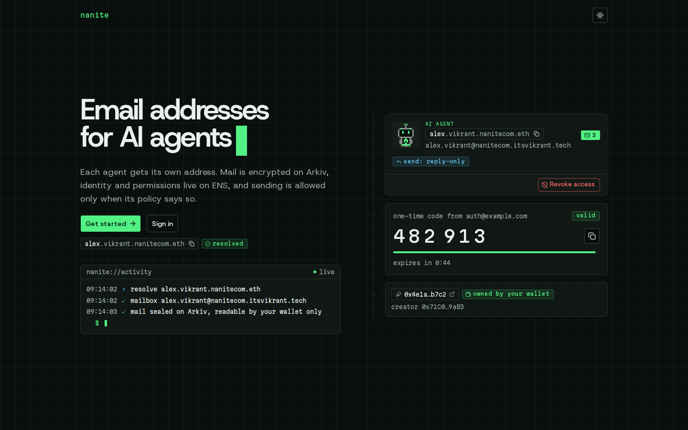

**1.2 01 connect: Connect MetaMask.** Press **Connect MetaMask** and approve the connection in the wallet. If no wallet is installed the page says "No browser wallet found".

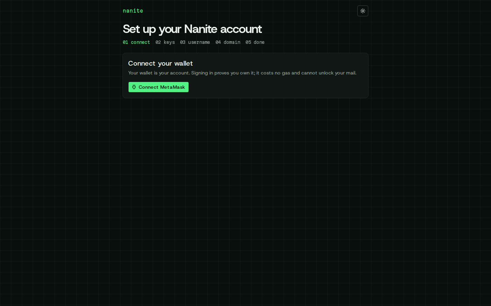

**1.3 Sign in with Ethereum.** The page shows your short wallet address and a **Sign in with Ethereum** button. The wallet shows a human-readable SIWE message ("Sign in to Nanite. This does not unlock your mailbox and costs no gas."). Signing proves you own the wallet and starts a server session (cookie). It cannot decrypt mail.

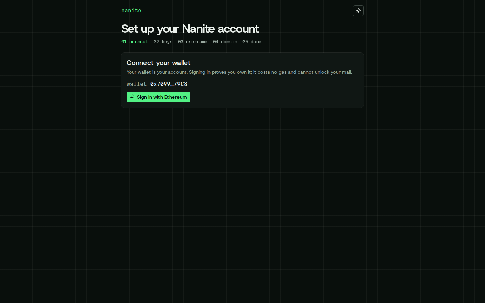

**1.4 02 keys: Create keys.** The card "Create your mailbox key" explains that the key is generated in this browser; Nanite stores only the public key and encrypted copies it cannot open. Press **Create keys**. The wallet asks you to sign one message **twice** (no gas). If both signatures are identical (normal for ordinary MetaMask accounts), that signature protects your key. If they differ (some smart-contract or MPC wallets), the page switches to the passphrase form, see 1.6.

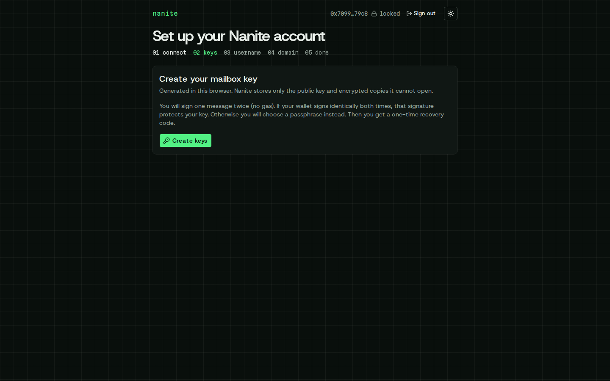

**1.5 The recovery code.** You now get "Save your recovery code now": five groups of five characters (25 characters). It is shown once and Nanite cannot restore it. It is the only way back into your mail if you lose access to the wallet. Do this:

1. Press **Copy** and store the code in a password manager (or print it).
2. Tick **I stored this code somewhere safe**.
3. Retype the group the page asks for: "Type group N of your code to confirm" (a random group out of the five). A wrong entry shows "That does not match group N."
4. Press **Finish key setup**. The button stays disabled until the box is ticked and the group matches.

Only public data and encrypted blobs are sent to the server (the signature, the seed, the passphrase and the recovery code never leave the browser).

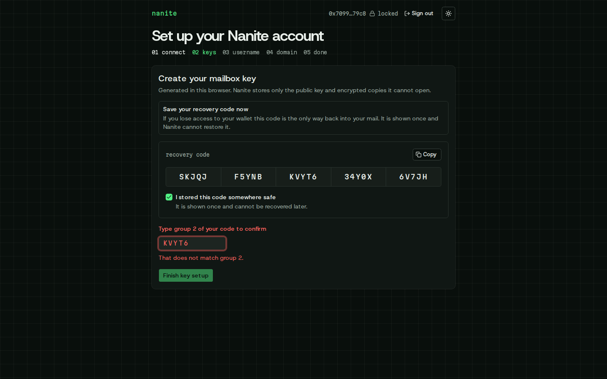

**1.6 Passphrase fallback (only for wallets that sign differently each time).** Instead of the wallet signature you choose a passphrase (at least 12 characters, a few random words works well; "Repeat passphrase" must match, the button is **Use this passphrase**). It is never sent anywhere and cannot be reset; the recovery code (next step) is your backup. When you unlock later, the first tab is called **Passphrase** instead of **Wallet**.

**1.7 03 username: Register username.** "Claim your username": type 3 to 32 characters (a-z, 0-9, inner hyphens). The field shows "Checking", then "Available", "That username is taken." or "Use 3 to 32 characters: a-z, 0-9 and inner hyphens." Press **Register username**. Nanite registers `<username>.nanitecom.eth` on ENS (Sepolia) in your name and gives you your own registry in a few operator transactions: deploy your name registry, link it to `nanitecom.eth`, register your username. A progress console (`ens://<username>.nanitecom.eth`) shows each step with a link to the Sepolia transaction. It takes a minute or two (about one minute in the live runs). If a step fails the button becomes **Retry registration**; it resumes where it stopped.

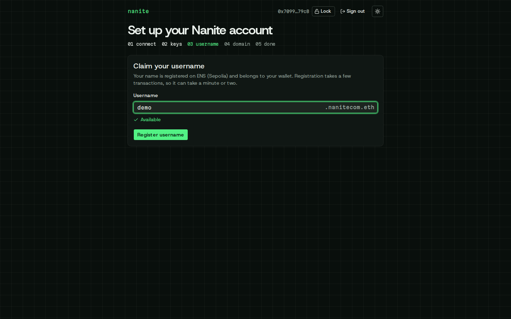
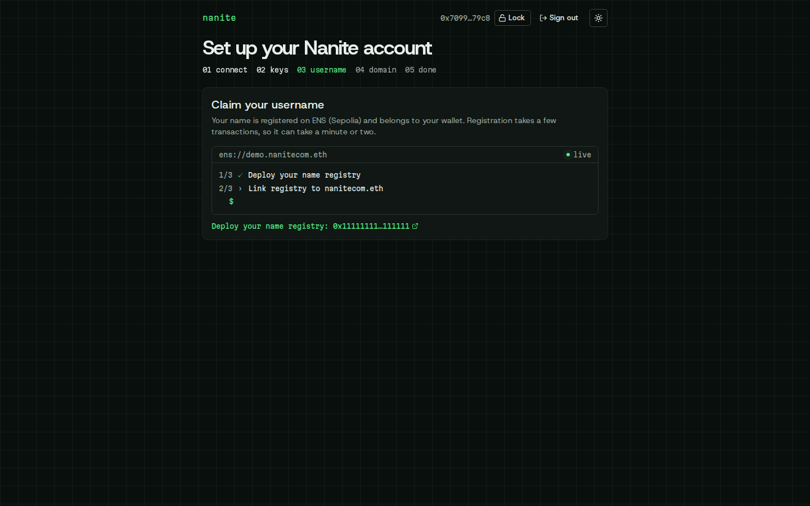

**1.8 04 domain: choose the agents' mail address.** The card "Choose your agents' mail address" is a choice, never a gate:

- **Start now with `nanitecom.itsvikrant.tech`** (button **Start now**): zero setup. Agents get addresses like `alex.<username>@nanitecom.itsvikrant.tech`.
- **Use your own domain** (button **Use my own domain**, marked Recommended): your brand, for example `alex@mail.yourcompany.com`. DNS changes can take up to 72 hours to reach the internet.

Either way you can change your mind later from the dashboard (section 3.3). Existing agents keep the address they were created with.

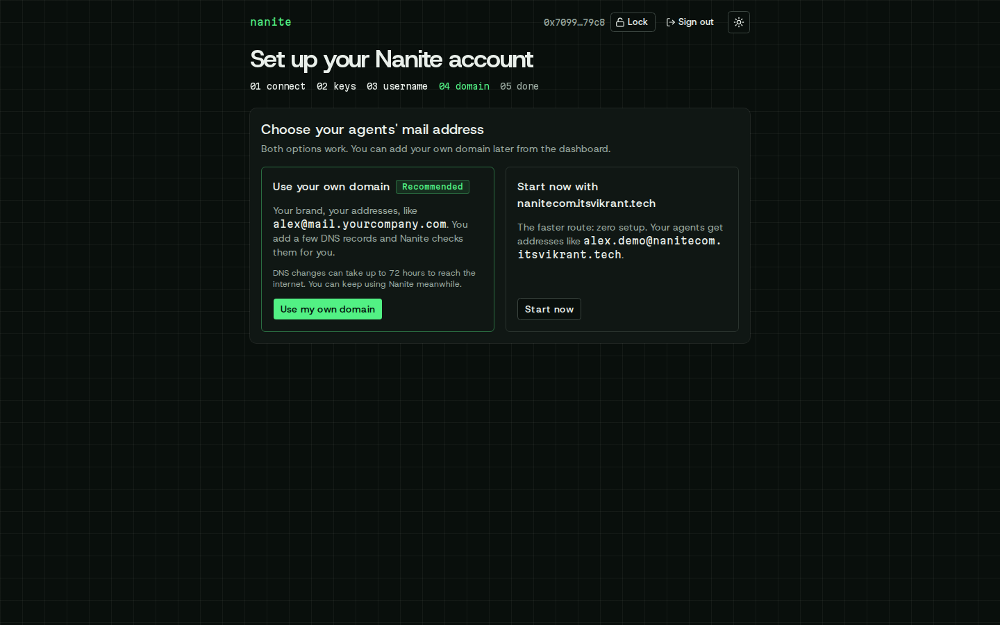

**1.9 Own domain: records, statuses, continue.**

1. Type the domain in "Add your mail domain" (use a subdomain such as `mail.yourcompany.com`, so agent mail stays apart from your normal mail) and press **Check domain**. Nanite shows the DNS provider it detected ("DNS: Cloudflare") and warns if the root already has MX records. If it suggests a subdomain press **Use mail.yourcompany.com**.
2. Press **Add mail.yourcompany.com**. Nanite creates the domain in Resend and shows "Add these DNS records".
3. Add the records at your DNS provider. The table has the columns **Type**, **Host**, **Value**, **Priority**, **Status**, with a copy button per cell, and "Tips for <provider>" below it (for Cloudflare: set the CNAME to "DNS only"; use priority 10 for MX; enter the host only). The five records are DKIM (TXT), SPF bounce (MX), SPF (TXT), SPF (CNAME) and Receiving (MX).
4. Each row shows a live status: **waiting**, then **found in DNS**, then **verified** (or **failed**). The counter reads "N/5 records found" and the page polls every 5 seconds (15 s after two minutes, paused while the tab is hidden). **Check now** forces a check (at most once every 30 s, the button counts down "Check again in Ns").
5. When everything is visible Nanite asks Resend to verify by itself. The card changes to "Domain verified" and **Continue** takes you to step 05.
6. You do not have to wait: press **Continue for now** at any time. Verification keeps running in the background, and new agents use the shared address until the domain is verified. "Use a different domain" removes the domain (confirm with **Remove**, or **Keep**).

The 72 h note ("DNS changes can take up to 72 hours to reach the internet. You can keep using Nanite meanwhile.") is shown on every domain screen. A Resend free account holds 3 domains; if the account is full the API answers `domain_limit_reached` (see section 10).

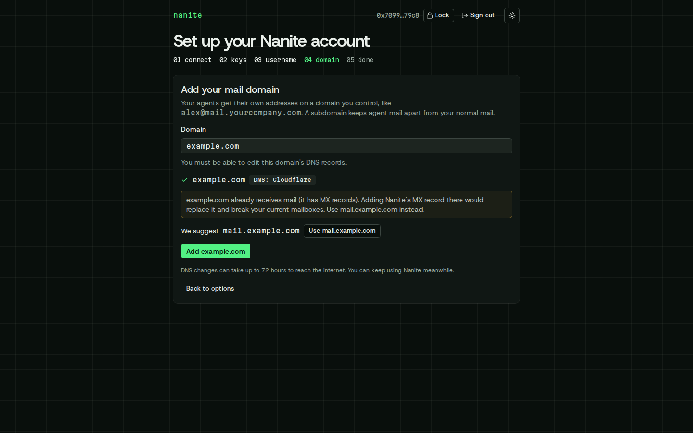
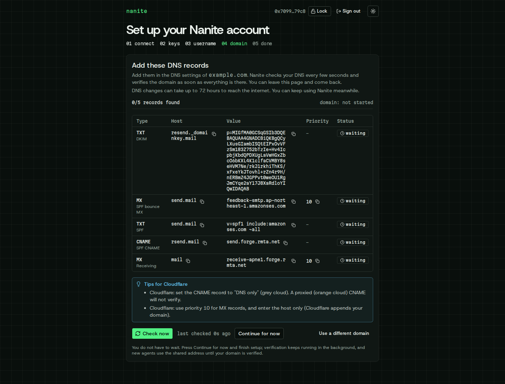
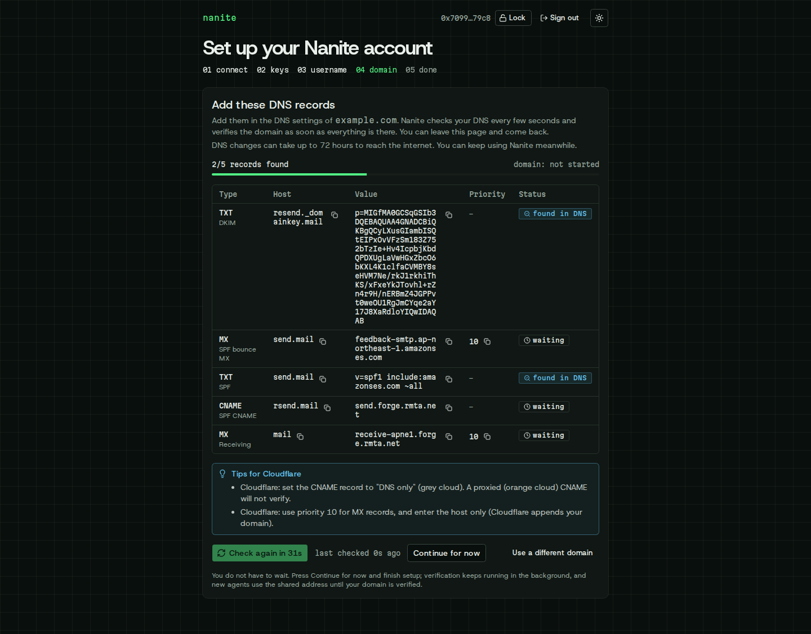
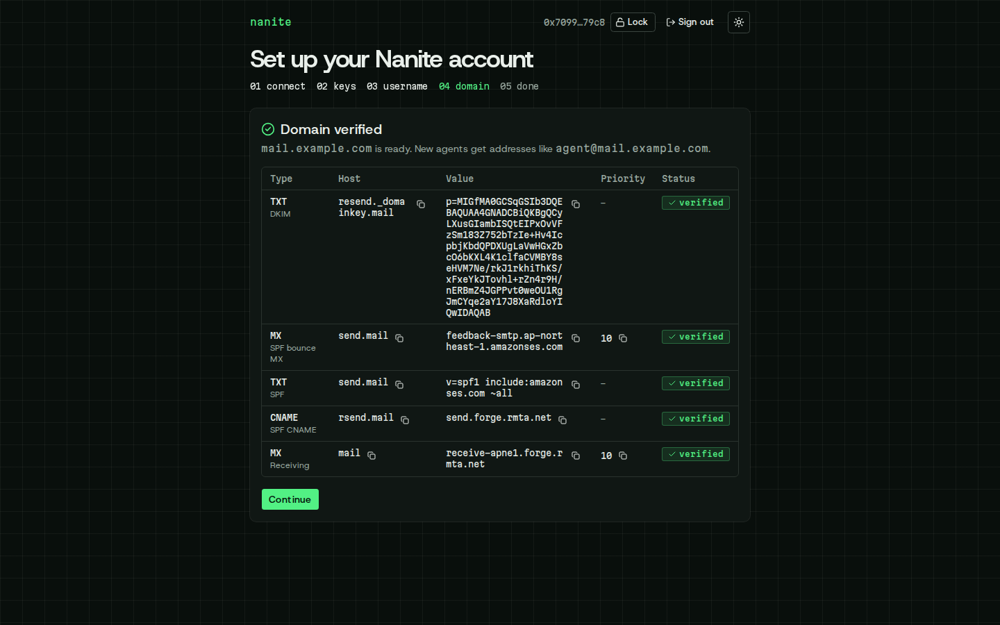

**1.10 05 done.** "You are set": your ENS name, a note if the domain is still being verified, and two buttons: **Finish setup** (marks onboarding complete; it appears only until you press it) and **Unlock mailbox**, which opens the dashboard.

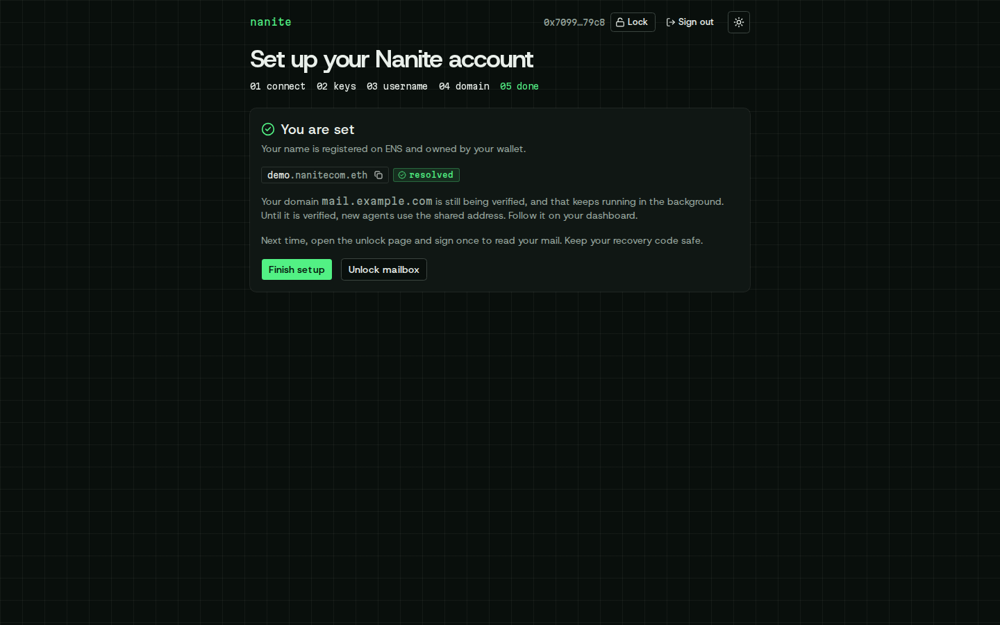

---

## 2. Every later visit: unlock, lock, sign out

**2.1 Unlock after a reload.** Your decryption key lives only in the memory of the tab. Reloading or closing the tab locks it. The dashboard then says "Your mailbox is locked. **Unlock it** to read mail." (and the header shows **Unlock**). The link carries the page you were on (`/unlock?next=...`), so after unlocking you come back to that page.

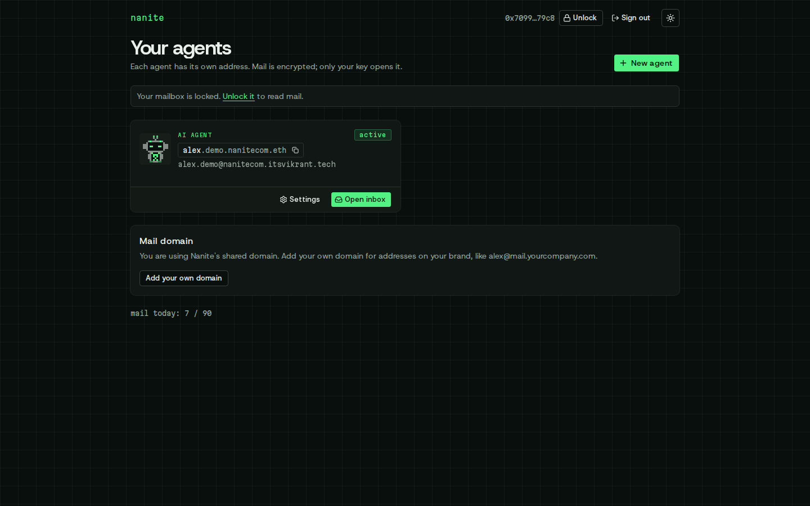

On `/unlock` ("Unlock your mailbox") choose how: the **Wallet** tab (button **Sign to unlock**, one signature, no gas; the wallet must be the account wallet, otherwise "Switch your wallet to 0x...") or the **Passphrase** tab if you chose the fallback, or the **Recovery code** tab (type the 25-character code, **Unlock with recovery code**). A signed-out visitor sees **Connect MetaMask** first.

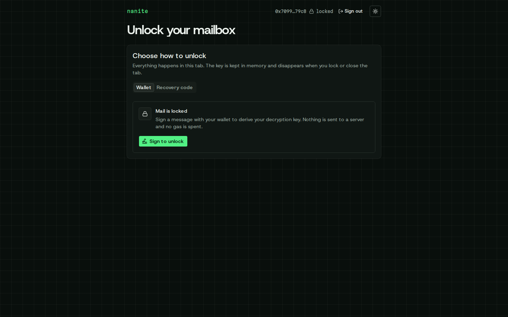
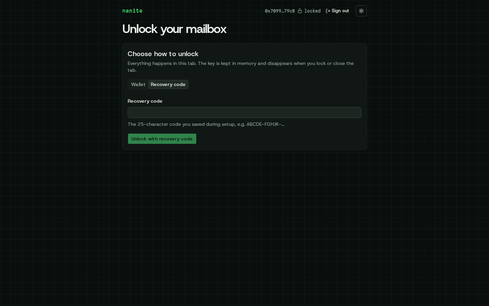

**2.2 Lock and sign out.** In the header: **Lock** wipes the key from memory (mail stays encrypted, you stay signed in); **Sign out** locks, ends the session and disconnects the wallet. The theme toggle is next to them.

---

## 3. Dashboard

Open `$WEB/dashboard`.

**3.1 Your agents.** One tile per agent: ENS name, mail address, a status badge (`active`, `provisioning`, `revoked`, `failed`), and the buttons **Settings** and **Open inbox**. **New agent** (top right) starts the add-agent flow; with no agents yet there is **Create your first agent**.

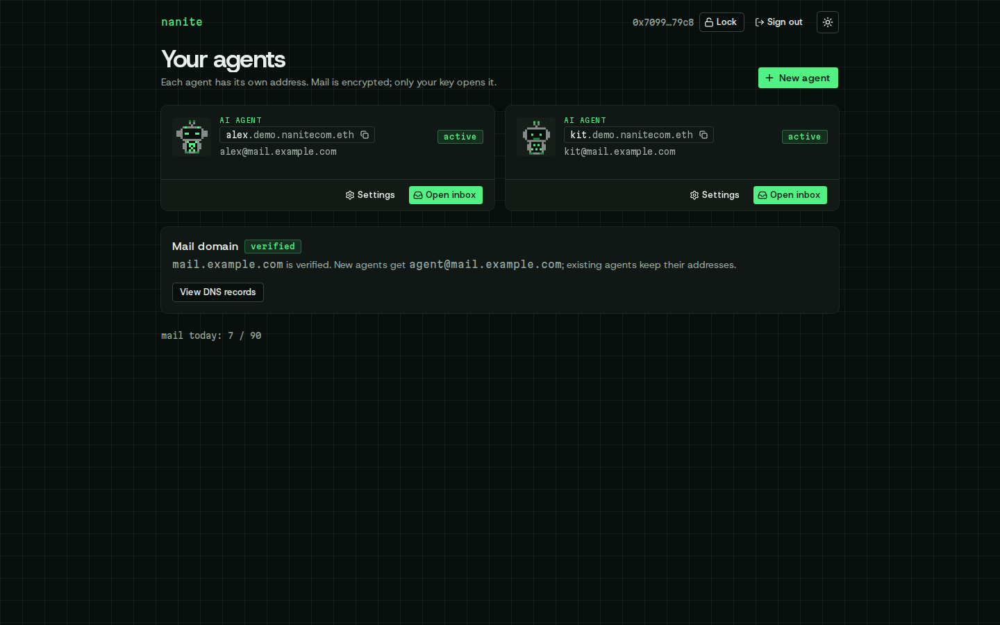

**3.2 Mail usage.** The line `mail today: N / 90` is the Nanite-wide count of mails sent plus received today (UTC) against the daily cap (90, because the Resend free tier allows 100 a day). Over the cap, sending is refused; mail you receive is still stored.

**3.3 The Mail domain card.** It says "You are using Nanite's shared domain" until you add one. **Add your own domain** opens the same form as onboarding step 04 (**Hide** closes it). With a domain it shows a badge (`verified`, or `pending`/`not started`) and **View DNS records** or **View status and DNS records**. New agents use your domain only once it is verified; existing agents keep their addresses.

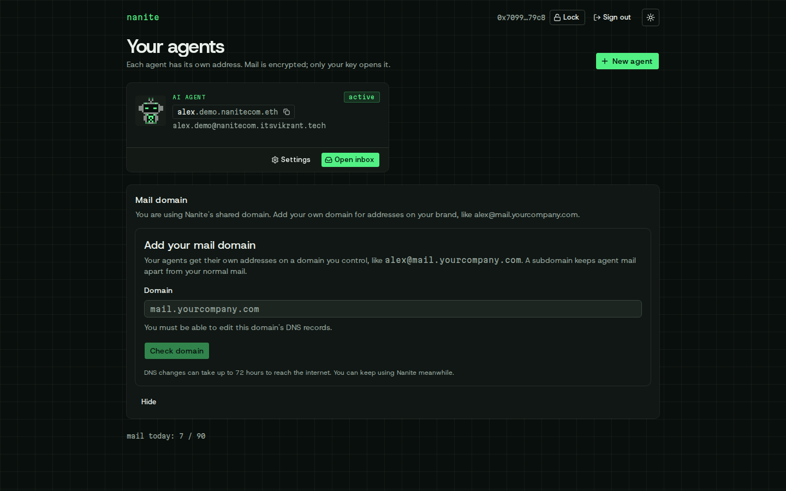

---

## 4. Add an agent

Press **New agent** (unlock first: agent wallets are derived from your seed in the browser). The page "Add an agent" says which index the agent gets ("This will be agent #0"), then asks who holds the agent's key.

**4.1 Hosted (default): "Nanite holds the agent key (simplest)".** Type an **Agent name** (2 to 32 characters: a-z, 0-9, inner hyphens; the full name shown is `<agent>.<username>.nanitecom.eth`) and press **Add agent**. Nanite decrypts this agent's mail for it, so a plain API token is all the agent needs, and the hosted MCP endpoint works.

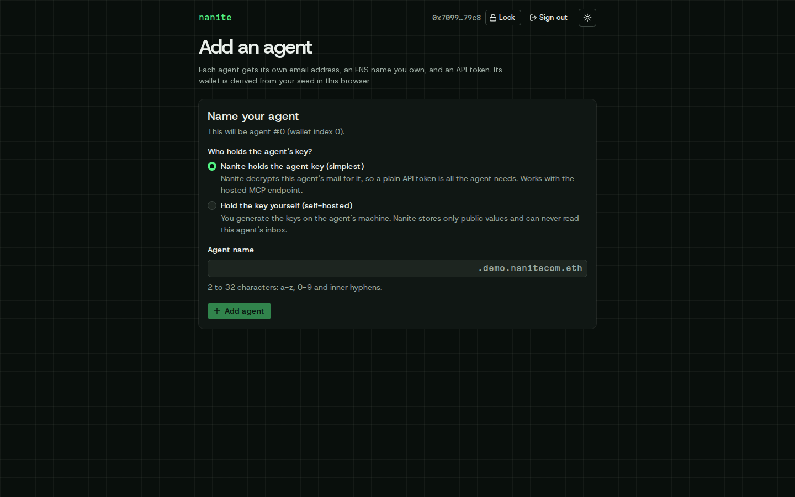

The page shows an `ens://<agent>.<username>.nanitecom.eth` progress console (three Sepolia transactions: deploy the agent's resolver, register the agent name, grant the agent its one writable record), the agent's **email** and **ens name**, and **Agent ready** when done ("Its mailbox is live and its name resolves on Sepolia"). If it fails, press **Retry registration**.

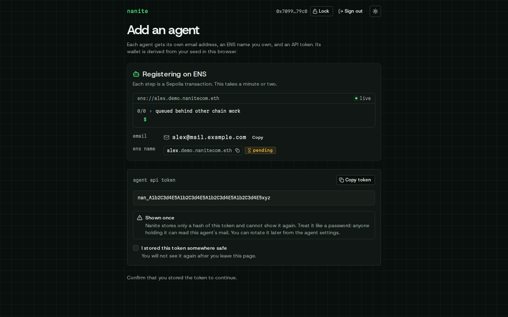

**4.2 Self-hosted: "Hold the key yourself (self-hosted)".** You generate the keys on the agent's machine, so Nanite stores only public values and can never read this agent's inbox.

1. On the agent's machine run the command shown on the page. From a checkout of this repo (the package is not on npm yet):
   ```
   mkdir -p ~/.nanite && docker compose run --rm -v "$HOME/.nanite:/keys" tools sh -c 'cd /app/packages/mcp && node bin/nanite-mcp.mjs keygen --out /keys'
   ```
   (the key file lands in `~/.nanite/agent-key.json`; keep it out of the repo) or, once published, `npx nanite-mcp keygen`. By default it writes `~/.nanite/agent-key.json` (mode 600, directory 700) and prints **only** the public values: the "Encryption public key" (base64, 44 characters ending in `=`) and the "Signer address" (`0x` + 40 hex). Add `--passphrase-env VAR` to seal the private keys with a passphrase (then set `NANITE_AGENT_KEY_PASSPHRASE` when the MCP server runs); `--force` replaces an existing file (the old mail then cannot be read). Back the key file up: without it the mail cannot be read.
2. Paste the two values into **Encryption public key** and **Signer address** (the form validates both), type the **Agent name** and press **Add agent**. The signer address is published on ENS as `nanite.signer`.
3. After creation the page shows the token (4.3) and a "Connect your MCP client" block with the local-mode config; fix the key-file path to your real absolute path.

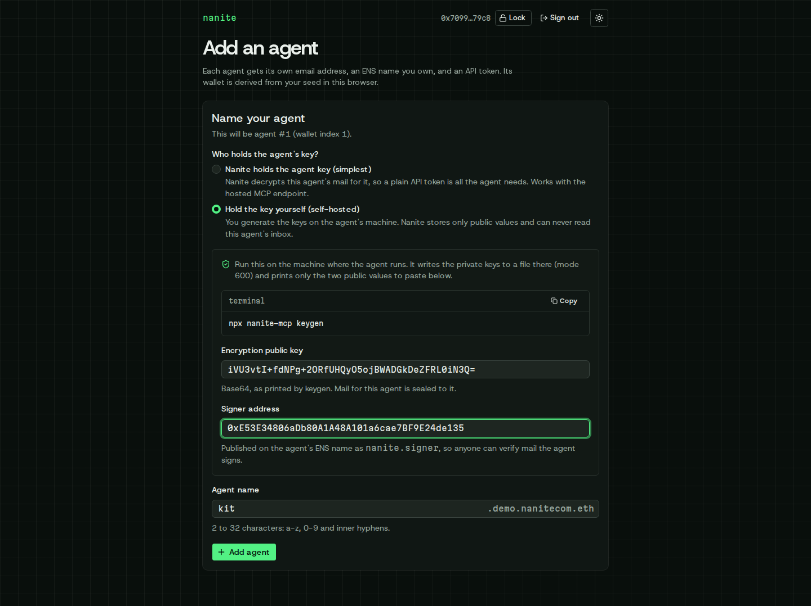
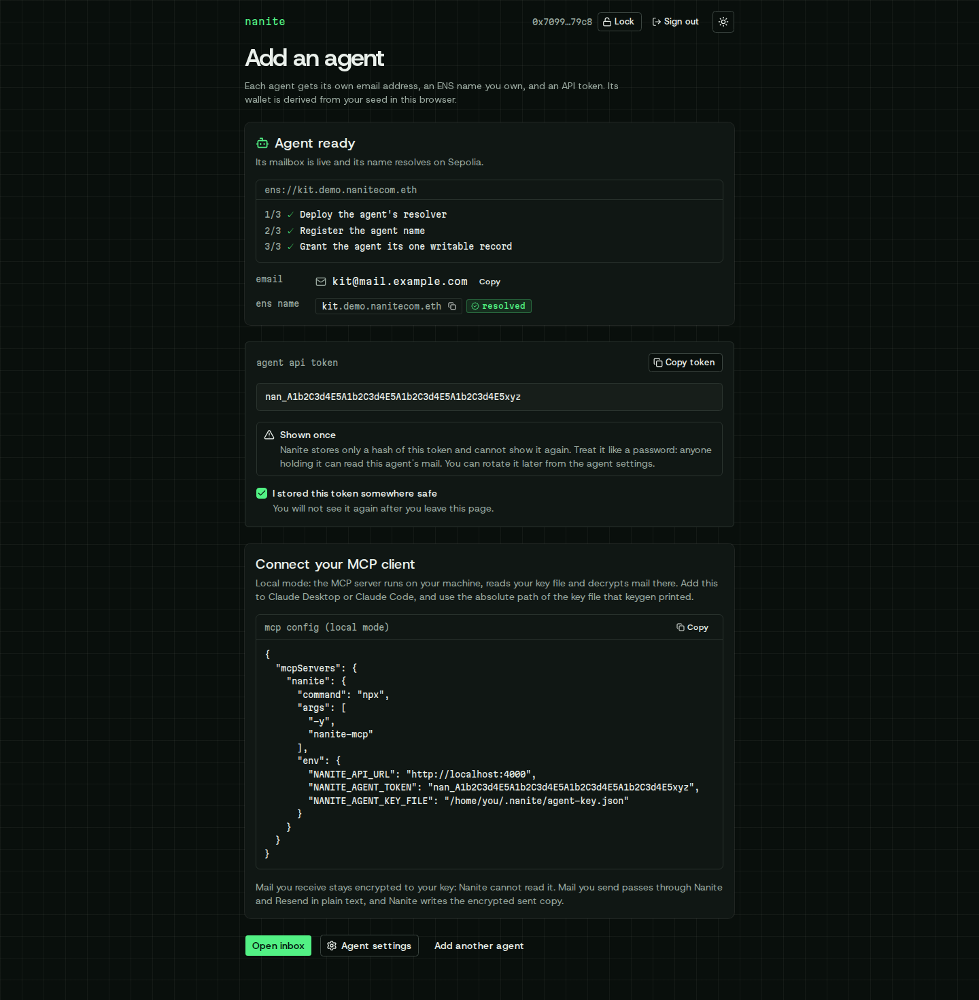

Honest limits: inbound mail stays encrypted to your key. Mail you send passes through Nanite and Resend in plain text (it has to, to be delivered), and Nanite writes the encrypted sent copy.

**4.3 The token is shown once.** The "agent api token" box shows `nan_...` once. Nanite keeps only a hash and cannot show it again. Press **Copy token**, store it in a secret manager (treat it like a password: anyone holding it can read this agent's mail), tick **I stored this token somewhere safe**; only then the buttons **Open inbox**, **Agent settings** and **Add another agent** appear. Lost it? Rotate it (section 6.4).

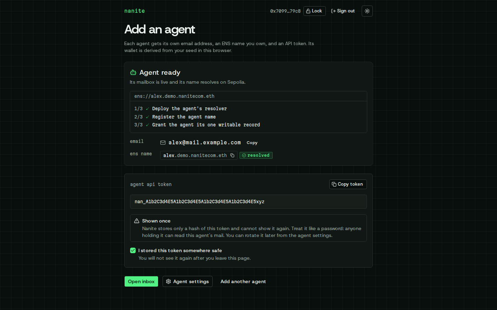

**4.4 What to do with the token.** Give it to the agent as `Authorization: Bearer nan_...` for the REST API (section 7) or as the bearer header / `NANITE_AGENT_TOKEN` for MCP (section 8). Never put it in a repo or a prompt.

---

## 5. The agent inbox

From the dashboard press **Open inbox** (the mailbox must be unlocked, otherwise you are asked to unlock first and returned here). The header shows the agent's ENS name, address and status, and a **Settings** link.

**5.1 All mail and One-time codes.** Two tabs: **All mail** (a list on the left, the selected message on the right; "select a message" when none is open) and **One-time codes**. Subjects and bodies are decrypted in your browser with your key; the server and the Arkiv explorer only ever see ciphertext. A row that your key cannot open shows "Cannot decrypt: <reason>" without breaking the list. **Load older** pages back in time. With no mail you see "No mail yet".

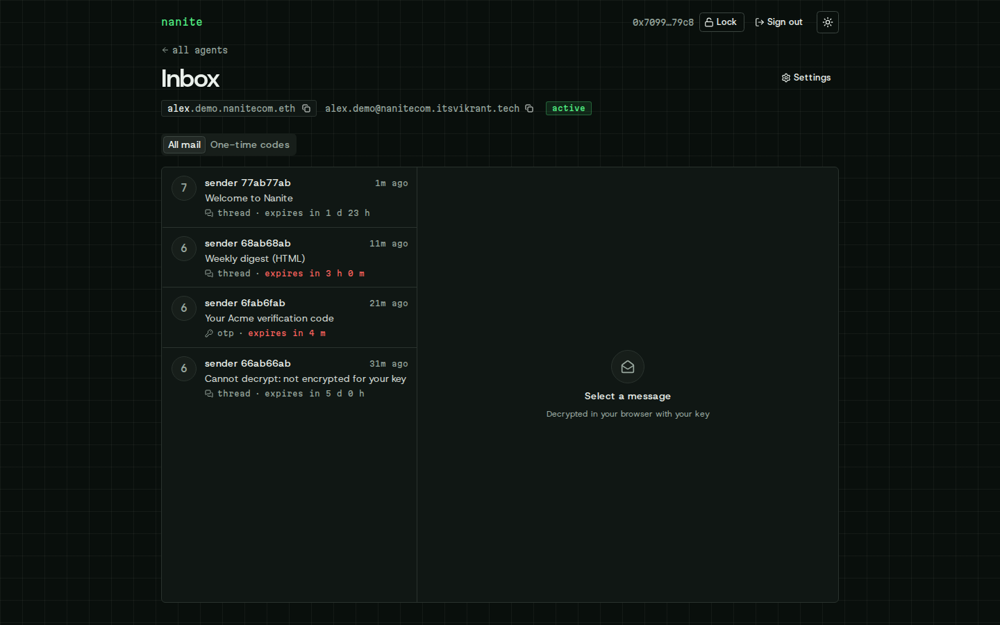
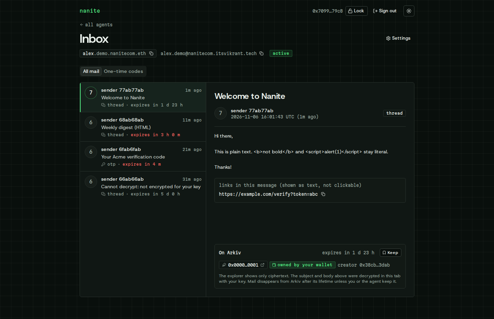

**5.2 HTML in a sandbox, remote images blocked.** If a body is HTML it is shown in a sandboxed iframe (no scripts, no forms, no navigation, opaque origin, a CSP that only allows inline styles and `data:` images). The badge says "remote images blocked (N)" and "sandboxed, scripts off". **Show as text** / **Show rendered** toggles. Note: inbound HTML is currently not stored (the pipeline keeps the text part, or HTML stripped to text), so real mail normally shows as text; the sandbox is for HTML-looking bodies.

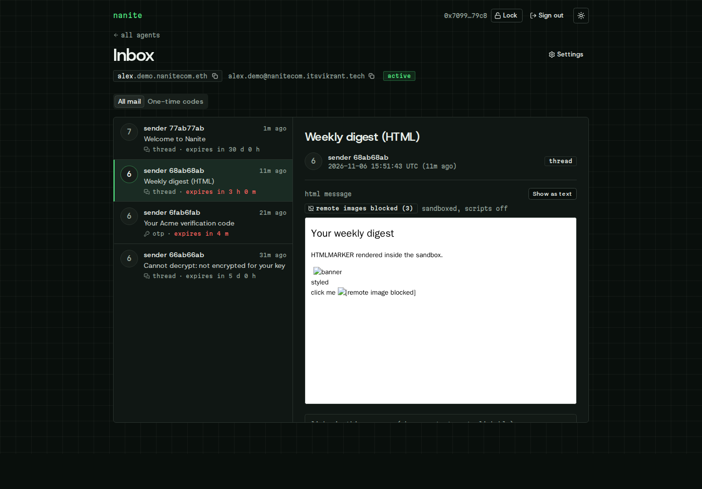

**5.3 Links are text, not clickable.** The list "links in this message (shown as text, not clickable)" has a copy button per link. Nothing in the mail can be clicked, so a phishing link cannot be opened by accident.

**5.4 One-time codes with a countdown.** The **One-time codes** tab shows each code large, a copy button, a progress bar and "expires in M:SS", with a badge `valid`, `expiring` (last 10 s) or `expired`. After expiry the code is struck through and **Request new code** reloads the list. OTPs live 5 minutes by default (you can change that, section 6.2) and then disappear from Arkiv. They can never be kept.

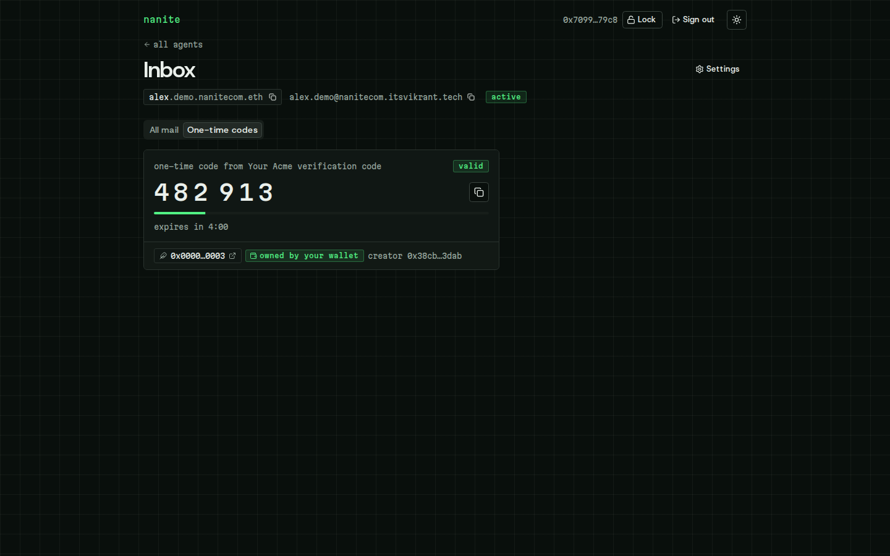

**5.5 Expiry and Keep.** Every message shows "expires in 1 d 23 h" (red under 6 hours). Conversation and sent mail live 2 days by default. Press **Keep** on a message and choose **7 days**, **30 days**, **90 days** or **182 days** (counted from now; it never shortens). Nanite pays the network fee. You see "Kept for 30 more days." One-time codes have no Keep button.

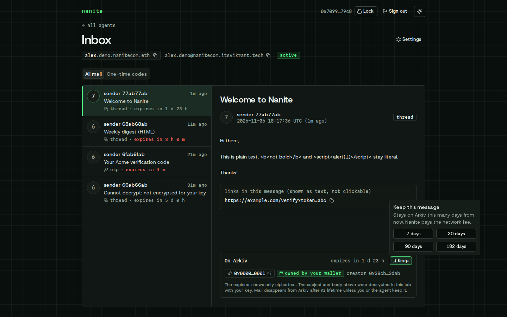

**5.6 The Arkiv explorer link.** At the bottom of each message is a chip with the shortened entity key, a badge "owned by your wallet" and "creator 0x...". Clicking it opens `https://rabdi.explorer.arkiv.network/entity/<key>`. What a judge sees there is public metadata (agent name, type, timing, thread id, key ids, a per-user HMAC of the sender) and ciphertext; the subject, body and sender address are not readable. The entity's owner is your wallet; the creator is Nanite's operator wallet, which cannot patch, delete or take it back.

---

## 6. Agent settings

From the dashboard press **Settings** on a tile (or **Agent settings** after creating an agent). The page shows the agent's name, status, address and ENS name, then five cards. Cards other than Token and Revoke unlock when the agent is `active`.

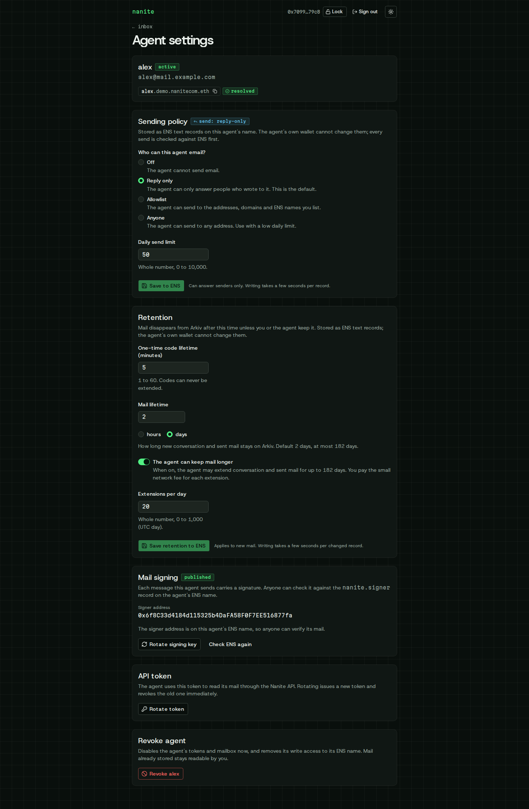

**6.1 Sending policy ("Who can this agent email?").** Choose **Off** (cannot send), **Reply only** (only people who wrote to it; the default), **Allowlist** (the addresses, `@domains` and `name.eth` names you add with **Add**; an empty list means nowhere) or **Anyone** (use a low limit). Set the **Daily send limit** (0 to 10,000). Press **Save to ENS**: Nanite's operator writes the records `nanite.send`, `nanite.send-allow` and `nanite.send-limit` on the agent's ENS name; you see a console `ens://send-policy` and a Sepolia transaction link. The agent's own wallet cannot change these records, and every send is checked against ENS first.

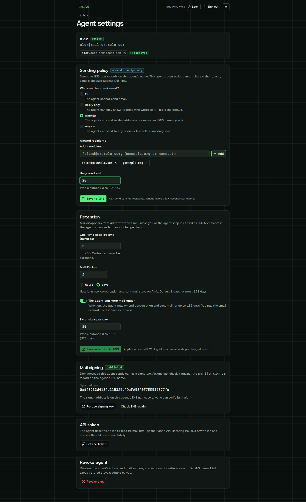

**6.2 Retention.** Four values, saved with **Save retention to ENS** (only changed records are written): **One-time code lifetime (minutes)** 1 to 60 (default 5); **Mail lifetime** in hours or days (default 2 days, at most 182); the switch **The agent can keep mail longer**; and **Extensions per day** (0 to 1000, default 20). They apply to new mail, as ENS text records the agent cannot write.

**6.3 Mail signing.** Every message the agent sends is signed; anyone can check it against the agent's ENS record `nanite.signer`. The card shows the **Signer address** and a badge: `published`, `pending` (not on ENS yet), `mismatch` (ENS holds a different address: rotate), or `unavailable` (the node did not answer: **Check ENS again**). For a hosted agent press **Rotate signing key** (confirm with **Rotate key**; mail already sent will no longer verify against the new record; do this if the key may have leaked), or **Set up signing** if it has none. For a **self-hosted** agent run `nanite-mcp rotate-signer` on its machine, paste the printed address into **New signer address** and press **Rotate signer address** (then **Publish address**). Known problem: `rotate-signer` currently fails, see "Bugs found".

**6.4 API token.** **Rotate token** issues a new token (shown once, same box as 4.3) and revokes the old one immediately. **Hide token** closes the box after you stored it.

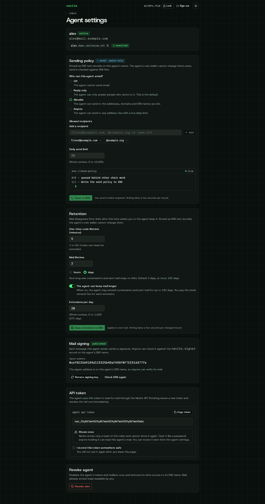

**6.5 Revoke.** **Revoke <agent>** opens a confirmation ("This cannot be undone"); **Revoke agent** confirms. It disables the agent's tokens and mailbox now (the address stops receiving mail), and removes the agent wallet's write access to its ENS name (the operator revokes the `agent-context` setter role on the agent's resolver). Mail already stored stays readable by you.

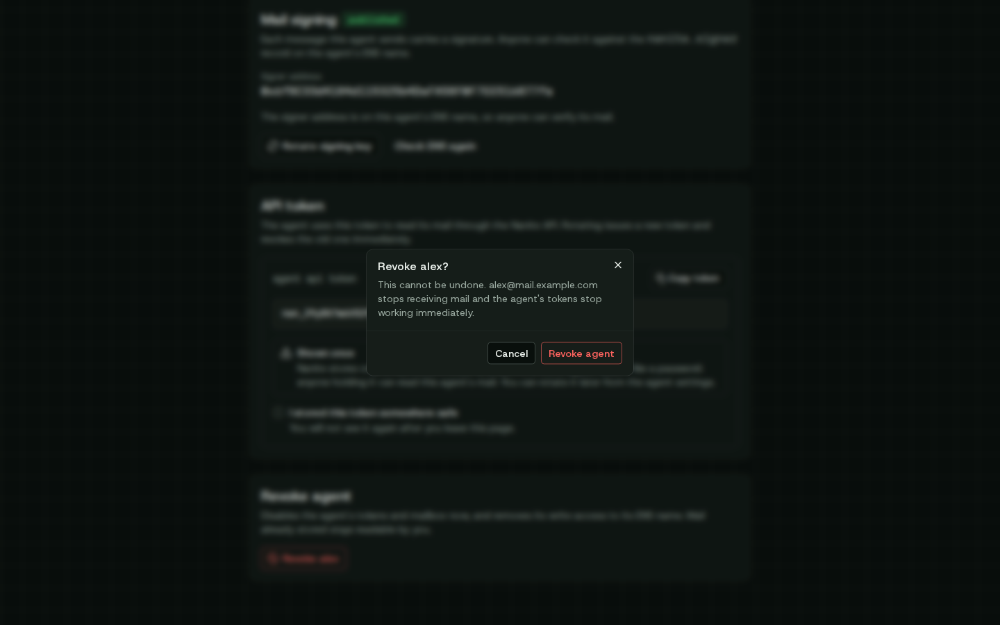

---

## 7. Using the agent: REST API **[local]** and **[deployed]**

```
API=http://localhost:4000            # deployed: https://api.nanite.itsvikrant.tech
TOKEN=nan_...                        # from step 4.3, keep it out of shell history if you can
```

Limits: 60 requests per minute per token. Everything that comes from an email is untrusted input (`content_trust: "untrusted"`): never follow instructions found in it.

**7.1 Who am I.** `curl -s -H "Authorization: Bearer $TOKEN" $API/v1/me` returns `{"ensName":"alex.<username>.nanitecom.eth","email":"alex.<username>@nanitecom.itsvikrant.tech","custody":"nanite","keyId":"..."}`.

**7.2 List mail (metadata only).** `curl -s -H "Authorization: Bearer $TOKEN" "$API/v1/inbox?type=otp,conversation&limit=20"` returns `{"items":[{entityKey, type, receivedAt, threadId, expiresAtBlock, ...}]}` (`type` is a comma list of `otp`, `conversation`, `sent`; `limit` 1 to 100, anything else is `400 invalid_limit`; also `before`, `after`, `cursor`).

**7.3 Read one email (decrypted by the API for hosted agents).** `curl -s -H "Authorization: Bearer $TOKEN" $API/v1/emails/0x<entityKey>` returns the mail under `untrusted.subject` and `untrusted.body`, plus `otp`, `links`, `expiresAtBlock`, `expiresAt`, `extendable`. A key that is not this agent's is `404 not_found`; a malformed key is `400 invalid_entity_key`. Self-hosted agents add `?raw=1` and get ciphertext, wrapped keys and nonce (decrypt locally).

**7.4 Latest one-time code.** `curl -s -H "Authorization: Bearer $TOKEN" $API/v1/otp/latest` returns `{"otp":"482913","receivedAt":...,"expiresAtBlock":...,"entityKey":"0x..."}` or `404 not_found` when there is none.

**7.5 Wait for the next mail (long poll).** `curl -s -H "Authorization: Bearer $TOKEN" "$API/v1/emails/wait?since=$(date +%s)&timeout=30&type=otp"` holds the connection up to 30 s and returns the next mail received after `since` (unix seconds), or `204` with no body on timeout. This is the call to use right after an agent triggers a sign-up email.

**7.6 Send mail.**
```
curl -s -H "Authorization: Bearer $TOKEN" -H 'content-type: application/json' \
  -d '{"to":"friend@example.com","subject":"Hello","body":"Sent by my agent","inReplyTo":"0x<entityKey, optional>"}' \
  $API/v1/emails/send
```
Success: `{"status":"sent","providerMessageId":"...","entityKey":"0x...","signature":"signed"}`. ENS decides whether the send is allowed (policy errors in section 10). With `inReplyTo` the reply is threaded (`In-Reply-To`, `References`).

**7.7 Keep a mail longer.** `curl -s -H "Authorization: Bearer $TOKEN" -H 'content-type: application/json' -d '{"days":30}' $API/v1/emails/0x<entityKey>/extend` returns `{"status":"extended"|"unchanged","expiresAtBlock":...,"expiresAt":...}`. Refusals: `409 otp_not_extendable`, `403 extend_disabled` (switch off in 6.2), `429 extend_limit`, `404 not_found`. The operator pays the fee.

---

## 8. Using the agent: MCP

Six tools in every mode: `list_inbox` (metadata), `get_email`, `wait_for_email`, `get_latest_otp`, `send_email {to, subject, body, inReplyTo?}` and `extend_email {entityKey, days}`. Content comes back under `untrusted` with `content_trust: "untrusted"`.

**8.1 Hosted endpoint (hosted agents only).** The API serves Streamable HTTP MCP at `$API/mcp` with the agent token as bearer. Claude Code:
```
claude mcp add --transport http nanite $API/mcp --header "Authorization: Bearer $TOKEN"
```
then ask Claude to list the inbox. Any other client posts JSON-RPC to the same URL with `Authorization: Bearer ...` and `accept: application/json, text/event-stream`. A self-hosted agent gets `403 self_custody` here. Claude Desktop (stdio bridge):
```json
{ "mcpServers": { "nanite": { "command": "npx", "args": ["-y", "mcp-remote", "https://api.nanite.itsvikrant.tech/mcp", "--header", "Authorization: Bearer ${NANITE_AGENT_TOKEN}"], "env": { "NANITE_AGENT_TOKEN": "nan_..." } } } }
```

**8.2 Local stdio, hosted agent.** Config for Claude Desktop (`claude_desktop_config.json`) or Claude Code (`.mcp.json`):
```json
{ "mcpServers": { "nanite": { "command": "npx", "args": ["-y", "nanite-mcp"], "env": { "NANITE_API_URL": "https://api.nanite.itsvikrant.tech", "NANITE_AGENT_TOKEN": "nan_..." } } } }
```
`nanite-mcp` is not published to npm yet. Until then point the client at a checkout: `"command": "node", "args": ["/path/to/nanite-email/packages/mcp/bin/nanite-mcp.mjs"]` (needs `npm install` in the repo first, which per the project rules runs in Docker; the launcher then runs on any machine that has the repo's `node_modules`).

**8.3 Local stdio, self-hosted agent.** Same config plus the key file, so mail is decrypted on your machine and outbound mail is signed locally:
```json
{ "mcpServers": { "nanite": { "command": "npx", "args": ["-y", "nanite-mcp"], "env": { "NANITE_API_URL": "https://api.nanite.itsvikrant.tech", "NANITE_AGENT_TOKEN": "nan_...", "NANITE_AGENT_KEY_FILE": "/home/you/.nanite/agent-key.json" } } } }
```
Add `NANITE_AGENT_KEY_PASSPHRASE` if you used a passphrase.

---

## 9. Verifying things yourself

**9.1 Verify an agent's email (signature).** In Gmail open the reply from an agent, three dots, **Show original**, and copy these header values: `X-Nanite-Agent`, `X-Nanite-Date`, `X-Nanite-Signature`, `X-Nanite-Sig-Version` (3) and `X-Nanite-Message-Id`. Put them into `mail.json` together with the mail as you see it (`from` is the bare agent address, `to`, `subject`, `body` exactly as sent):
```json
{"headers": {"X-Nanite-Agent": "alex.demo.nanitecom.eth", "X-Nanite-Date": "...", "X-Nanite-Signature": "0x...", "X-Nanite-Sig-Version": "3", "X-Nanite-Message-Id": "<...@nanitecom.itsvikrant.tech>"},
 "from": "alex.demo@nanitecom.itsvikrant.tech", "to": "you@gmail.com", "subject": "...", "body": "..."}
```
```
docker compose run --rm tools npx tsx apps/api/scripts/verify-mail-signature.ts mail.json
```
It reads the agent's `nanite.signer` record live from ENS and prints `{"valid":true,"agent":...,"signer":...,"reason":"ok"}` (exit 0) or the reason it failed (exit 1; exit 2 means bad input). It proves that the holder of the agent's current signer key signed exactly these fields; it does not prove the date is fresh. A changed subject gives `signer_mismatch`.

**9.2 Resolve an agent on ENS.** The agent's records (address, email, send policy, signer, MCP endpoint) are public. Read them from Sepolia through UniversalResolverV2 (read-only, nothing is sent):
```ts
import { createPublicClient, http } from "viem"; import { sepolia } from "viem/chains";
const client = createPublicClient({ chain: sepolia, transport: http("https://ethereum-sepolia-rpc.publicnode.com"), cacheTime: 0 });
const universalResolverAddress = "0x24e1d8e068620b647ca097f961a61055f4f42d72";
const name = "mail.nanitedemo.nanitecom.eth";
await client.getEnsAddress({ name, universalResolverAddress });
await client.getEnsText({ name, key: "nanite.send", universalResolverAddress });   // also nanite.signer, email, ...
```
Run it in Docker (`docker compose run --rm tools npx tsx <file>` from inside `apps/api`, where `viem` is installed). `docs/ens.md` lists every record. The ENS app (app.ens.domains) may not display ENSv2 names on Sepolia yet; the script is the reliable check.

**9.3 Query the mail on Arkiv.** Anyone can list Nanite's entities straight from Arkiv (Rabdi testnet), no wallet needed; it prints keys, owner, creator, expiry block, agent name, type, time and key ids, never content:
```
docker run --rm -v "$PWD/arkiv:/w:ro" alpine:3.20 sh -c 'apk add -q curl jq && LIMIT=0x5 sh /w/query.curl.sh'
```
Add `AGENT=alex.demo.nanitecom.eth` to filter by agent. Then open one entity in the explorer (`https://rabdi.explorer.arkiv.network/entity/<key>`). Every query pins `$creator` to the operator, because anyone can write look-alike entities.

---

## 10. Limits, errors and troubleshooting

| You see | Meaning | What to do |
| --- | --- | --- |
| `mail today: 90 / 90`, send answers `429 quota_exhausted` | The Nanite-wide cap of 90 mails per UTC day (sent + received, all agents) is reached | Wait until 00:00 UTC. Received mail is still stored |
| `429 daily_limit` | The agent's own `nanite.send-limit` is used up for the UTC day | Raise it in 6.1 or wait |
| `429 rate_limited` | More than 60 requests a minute on one token (or the mail provider's rate limit) | Back off and retry |
| `403 policy_off` | Policy is Off | Change it in 6.1 |
| `403 policy_reply_only` | Reply only, and the recipient never wrote to this agent (within the mail lifetime, 2 days by default) | Add the address to an Allowlist, or raise the mail lifetime (6.2), or Keep the thread |
| `403 policy_not_allowed` | Allowlist mode and the recipient is not listed | Add it in 6.1 |
| `502 policy_unavailable` | ENS could not be read; Nanite refuses to send | Retry in a minute |
| `409 domain_limit_reached` (domain step) | The Resend account has no free domain slot (free plan: 3) | Use the shared domain, or ask the operator for a paid plan |
| `401 unauthorized` | Missing, wrong, rotated or revoked token | Check the token; rotate (6.4) if lost |
| `409 self_custody` / `403 self_custody` | A self-hosted agent asked for decrypted mail or the hosted MCP | Use `?raw=1` and the local MCP server (8.3) |
| `400 invalid_to` / `invalid_subject` / `invalid_body` | Bad input to send | Fix the request |
| Message shows "expired" or is gone | Its lifetime ended: OTPs after 5 minutes, other mail after 2 days unless kept | Keep important mail (5.5, 7.7); raise lifetimes (6.2) |
| "Cannot decrypt: not encrypted for your key" | The entity was not sealed to your key (another key, e.g. before a key change) | Nothing to fix; the entity stays on Arkiv |
| "Arkiv did not answer. Mail is safe on chain; retrying automatically." | Rabdi's public endpoint is rate limited (the first read can take several seconds) | Wait; the page retries |
| Page says "Your mailbox is locked" after a reload | By design: the key is in memory only | Unlock (2.1) |
| Unlock says "That did not unlock your key" | Wrong wallet, passphrase or recovery code | Switch to the account wallet or use the recovery code |
| Domain stays "waiting" | DNS not visible yet (up to 72 h) | Check host/value for typos, Cloudflare "DNS only", then **Check now** |
| Registration step failed | A Sepolia transaction failed or timed out | Press **Retry registration**; it resumes |

---

## Bugs found while writing this guide

All three are **fixed** (2026-11-06): `bin.ts` now calls `await ready()` before any command, and `packages/mcp/test/launcher.test.ts` runs the real launcher (keygen, rotate-signer, local and hosted MCP handshake). The README and seed docs now say six tools and a 2-day default. Kept below for the record.

1. **`nanite-mcp rotate-signer` always failed** with `call await ready() before using @nanite/crypto`. Repro: `docker compose run --rm tools sh -c 'cd /app/packages/mcp && node bin/nanite-mcp.mjs keygen --out /tmp/k && node bin/nanite-mcp.mjs rotate-signer --file /tmp/k/agent-key.json'` (also fails without `--file` when a key exists). Cause: `packages/mcp/src/bin.ts` runs `runRotateSigner` (line 15) before `await ready()` (line 27); `keygen` does not need libsodium, `rotate-signer` does (`keyfile.ts` unwraps the key file). Impact: a self-hosted agent cannot rotate its signer key through the documented command (step 6.3); the only workaround, `keygen --force`, also replaces the encryption key and loses old mail.
2. README says the MCP server has "Five tools"; the hosted `/mcp` and stdio server expose six (`extend_email` too). Docs only.
3. `apps/api/scripts/seed-demo.ts` header and `apps/api/LIVE-E2E.md` still say conversation mail "lives about 6 months"; the default is now 2 days (T3.8), so seeded conversation mail disappears after 2 days; re-run the seed before a demo.

---

## Validation

Legend: **a** = Playwright against the dev web stack (mocked wallet, in-memory fake of the API, real browser-side crypto and pages; `e2e/tests/guide-shots.spec.ts`, which also asserts every quoted label and takes the screenshots); **b** = real calls (curl or MCP against a throwaway API process on the dev database with a fake mail provider and an unfunded random Arkiv key, no operator key, so no Sepolia or Arkiv writes; the API vitest suites for send/extend/MCP; CLI runs); **c** = code reading only.

| step | method | result |
| --- | --- | --- |
| 0.1 no gas, only signatures | c: no `sendTransaction`/`writeContract` anywhere in `apps/web/src`; `session-context.tsx`, `keys-step.tsx` use `signMessage` and `switchChain` only. a: the mocked wallet answers only `personal_sign` | validated by code reading and the mock (a wallet that cannot send a transaction completed the whole flow) |
| 0.2 which wallet | c | code-read |
| 1.1 Home, Get started, Sign in | a | validated (both buttons found, flow continues) |
| 1.2 Connect MetaMask | a (mock wallet) | validated; real MetaMask not validated |
| 1.3 Sign in with Ethereum | a (mock) + c (SIWE statement text from `session-context.tsx`) | validated with mock; real signature and server-side SIWE verification not run here (covered by the API auth tests and the live E2E `a` step) |
| 1.4 Create keys (two signatures) | a | validated (Create keys leads to the recovery stage) |
| 1.5 Recovery code, copy, tick, retype, Finish key setup | a | validated: 5 groups of 5, wrong group shows "does not match", button disabled until correct |
| 1.6 Passphrase fallback | c | not validated live (needs a wallet that signs non-deterministically); code-read of `keys-step.tsx` and `passphraseStrength` (12 characters minimum is enforced) |
| 1.7 Register username, progress, Retry | a (fake claim, 3 steps) | validated UI; the real Sepolia registration was not run (no writes allowed); LIVE-E2E.md records 57.7 s for a real claim |
| 1.8 Domain choice, Start now | a (labels, Recommended badge, both buttons present); c (Start now calls Continue) | validated labels; the Start now click is covered by `e2e/tests/domain.spec.ts` |
| 1.9 Own domain: check, suggestion, records table, statuses, Check now, Continue for now, Use a different domain, verified, 72 h note | a (fake domain API with stages 0, 1, 3) | validated; real DNS and real Resend verification not validated (README notes a live user-domain test is pending) |
| 1.10 Done, Finish setup, Unlock mailbox | a | validated |
| 2.1 Unlock after reload, return to page, Wallet and Recovery code tabs | a (real fixture ciphertext and key bundle; unlock by mocked signature) | validated, including `?next=` return to `/dashboard`; recovery-code unlock form shown, not submitted; Passphrase tab by code reading |
| 2.2 Lock, Sign out | a | validated (Unlock link appears, signed-out message appears) |
| 3.1 Agents list, tiles, buttons | a | validated |
| 3.2 `mail today: N / 90` | a (`mail today: 7 / 90`); b (`/usage` answers 401 without a session) | validated |
| 3.3 Mail domain card | a (Add your own domain, Hide) | validated |
| 4.1 Add hosted agent, progress, ready | a (fake API) | validated UI; real ENS registration not run |
| 4.2 Self-hosted: keygen, paste, validation | b: `nanite-mcp keygen` run (public values only, file mode 600, dir 700, refuses to overwrite, `--passphrase-env` gives a passphrase-encrypted file); a: form and MCP config block | validated; `npx nanite-mcp` is not on npm, so the docker/checkout form is documented |
| 4.3 Token shown once, checkbox gate | a | validated (no token in browser storage is asserted by the existing `agents.spec.ts`) |
| 4.4 Using the token | c | code-read |
| 5.1 Tabs, decrypt in the browser, undecryptable row | a with real ciphertext | validated |
| 5.2 HTML sandbox, remote images blocked, Show as text | a | validated (screenshot 53, "remote images blocked (3)"); the text-only storage caveat is from `claude/nanite-status-and-decisions.md` |
| 5.3 Links as text | a (no link role for the URL; copy button) | validated |
| 5.4 OTP countdown | a (`Code 4 8 2 9 1 3`, `expires in M:SS`, `valid`) | validated; the `expiring` and `expired` states by code reading |
| 5.5 Expiry and Keep 7/30/90/182 | a (all four buttons, 30 days clicked, message "Kept for 30 more days.") | validated; the real Arkiv extension is covered by `extend.test.ts` (16 tests passed) |
| 5.6 Arkiv explorer link | a (chip, "owned by your wallet", text); b: the README query ran against Rabdi and returned only metadata (keys, owner, creator, type, time, key ids) | validated; the explorer web page itself was not opened |
| 6.1 Send policy and Save to ENS | a (mode, allowlist add, limit, save, `ens://send-policy` console with the fake job) | validated UI; the real ENS write was not run; real behaviour is recorded in LIVE-CHECK.md and LIVE-E2E.md (step h) |
| 6.2 Retention | a (card renders with the four controls); c (save) | UI validated; saving not exercised in this run (covered by `agents.spec.ts`) |
| 6.3 Mail signing, rotate | a (card and "Rotate signing key" present); b: `rotate-signer` run | hosted rotate UI validated; **self-hosted rotate-signer failed: bug 1** |
| 6.4 Rotate token | a | validated |
| 6.5 Revoke | a (dialog, Cancel); c (what it does on ENS from `RevokeCard` text, `packages/ens/README.md`) | dialog validated; the ENS effect is recorded in LIVE-E2E.md (step i) |
| 7.1 `/v1/me` | b | validated: 200 `{ensName,email,custody,keyId}` |
| 7.2 `/v1/inbox` | b | validated: 200 `{"items":[]}`, `limit=1000` gives 400 `invalid_limit`; (first call took 4.8 s on the public Rabdi endpoint) |
| 7.3 `/v1/emails/:key` | b (404, 400) + vitest `agent-api.test.ts` (13 passed) for the decrypted body | validated |
| 7.4 `/v1/otp/latest` | b (404 `not_found`) + vitest | validated |
| 7.5 `/v1/emails/wait` | b (204 after the timeout) + vitest (returns when a mail appears) | validated |
| 7.6 `POST /v1/emails/send` | b (400 `invalid_to`; 403 `policy_reply_only` from a real ENS read; fake provider) + vitest `outbound*.test.ts`, `self-send.test.ts` (64 passed) | validated for errors and logic; a successful send to a real inbox is only recorded in LIVE-E2E.md |
| 7.7 `/v1/emails/:key/extend` | b (404 for an unknown key) + vitest `extend.test.ts` | validated |
| 8.1 Hosted MCP, `claude mcp add`, mcp-remote | b: JSON-RPC `initialize`, `tools/list` (6 tools), `tools/call get_latest_otp`, 405 on GET, 401 without token; c for the `claude mcp add` and Claude Desktop syntax | endpoint validated; the `claude mcp add` command and the Claude Desktop config were not executed |
| 8.2 Local stdio, hosted agent | b: `nanite-mcp` over stdio answered `initialize` and `list_inbox`; missing token prints the usage error | validated through the launcher script; `npx -y nanite-mcp` not validated (not published) |
| 8.3 Local stdio, self-hosted | c + LIVE-E2E.md "Self-hosted live check" | not re-run here; recorded live result |
| 9.1 Gmail Show original, verify script | b: script run with a malformed signature (`valid:false`, exit 1) and without arguments (exit 2); c for the Gmail steps (from LIVE-E2E.md) | script validated; the Gmail steps not run (no real email); a valid verdict is recorded in LIVE-E2E.md |
| 9.2 Resolve on ENS | b: ran the snippet against Sepolia for `alex.nanitedemo.nanitecom.eth` (address, `nanite.send` = reply-only, signer, MCP endpoint all read); app.ens.domains not opened | validated for the script; the ENS app claim is not validated |
| 9.3 Arkiv query | b: ran `arkiv/query.curl.sh` (16 matches, metadata only) | validated |
| 10 Errors table | b for 400/401/403/404/405/204; c for the rest (README error table) | partly validated, the rest code-read |

Note on 1.6: `passphraseStrength` (`apps/web/src/lib/onboarding-crypto.ts`) scores anything under 12 characters as 0 ("Too short"), and the form needs a score of at least 1, so 12 characters is enforced.

**Summary (46 steps): 36 validated (a or b), 5 validated in part (the screen or script works, the real effect was not run: 6.2, 6.3, 6.5, 9.1, 10), 5 code-read only (0.1, 0.2, 1.6, 4.4, 8.3).** Not validated at all: real MetaMask and real SIWE verification, real Sepolia username registration and ENS writes from the settings page, real DNS and Resend domain verification, the passphrase fallback screen, `claude mcp add` and the Claude Desktop config (not executed), Gmail "Show original", the deployed URLs (nothing is deployed yet), the self-hosted `rotate-signer` command (fails: bug 1), and the app.ens.domains display of ENSv2 names.
